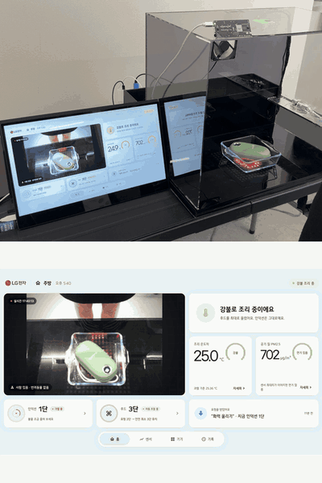
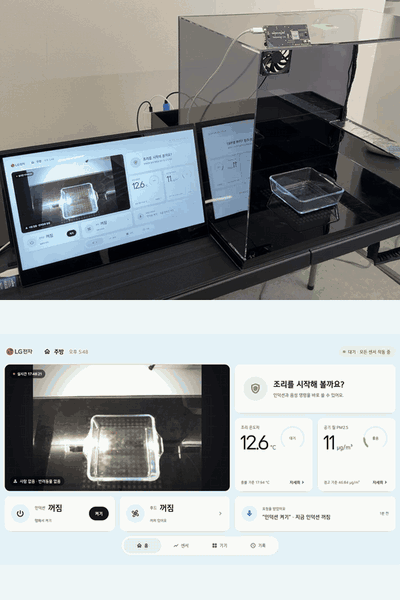
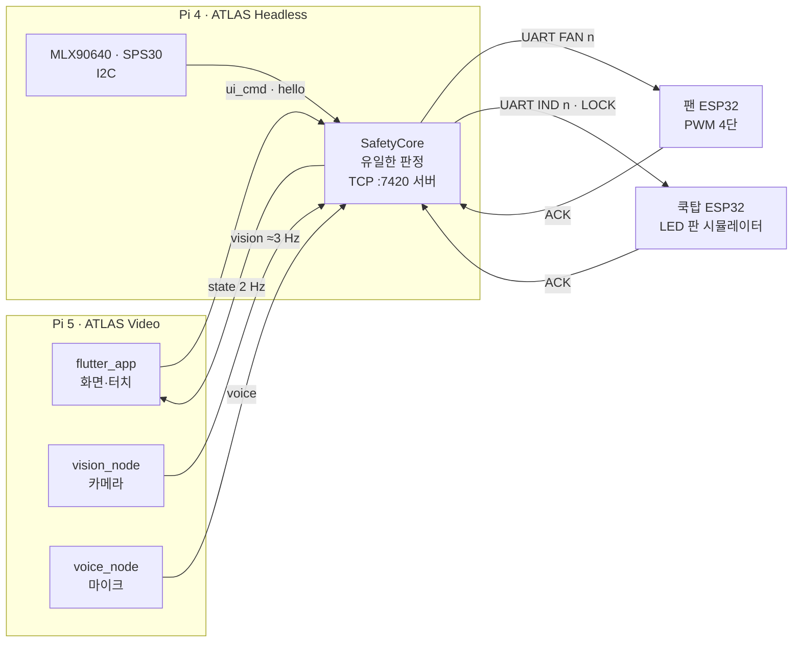

# HOOD&SEEK 🍳🔥

> 제24회 임베디드SW경진대회 스마트 가전 부문 · Team Ro92n
>
> 🏆 **전체 대상 (산업통상부 장관상)** — 2026-11-16 결선 결과 발표 ([공지](https://www.eswcontest.or.kr/community/notice.php?ptype=view&idx=5675&page=&code=notice))

[](LICENSE)
[](https://github.com/lambdaramji/2026ESWContest_smart_Ro92n)
[](https://github.com/lambdaramji/2026ESWContest_smart_Ro92n/actions/workflows/system.yml)
[](https://github.com/lambdaramji/2026ESWContest_smart_Ro92n/actions/workflows/flutter.yml)
[](https://www.eswcontest.or.kr/community/notice.php?ptype=view&idx=5675&page=&code=notice)

인덕션과 후드를 하나의 협력형 주방 안전 시스템으로 묶어, 화재 직전 단계를 기기 안(온디바이스)에서 미리 감지하고 열원을 끄고 환기를 올리는 스마트 키친 솔루션입니다.

쿡탑은 실제 인덕션이 아니라 ESP32와 LED 판으로 만든 시뮬레이터입니다. 이 문서의 「인덕션(시뮬레이터)」은 이 LED 판을 뜻합니다.

## 데모

**시연 영상 (3분):** [youtu.be/PRvTln311Lc](https://youtu.be/PRvTln311Lc)

<table>
  <tr>
    <td align="center"><br>화재 위험 감지 → 인덕션(시뮬레이터) 차단·잠금 (5배속)</td>
    <td align="center"><br>사람이 없을 때 고양이 감지 → 잠금 (3배속)</td>
  </tr>
</table>

두 GIF는 시연 영상의 촬영 원본에서 잘라 낸 것으로, 위는 기기, 아래는 같은 순간의 앱 화면입니다.

11/6 결선 현장 시연에서 아래 6장면을 4분 안에 모두 보였습니다(영상 클립 대체 없음). 실제 화염 대신 온도를 맞춘 손난로와 인센스 연기로 조리 상황을 재현합니다. 장면마다 같은 상태의 화면 목업을 링크했습니다.

1. **약불 켜기** — 터치로 인덕션(시뮬레이터) 1단을 켜면 후드가 함께 돕니다. → [목업](docs/ui-mockup/v1/Main.html)
2. **음성 명령** — 「하이엘지 후드 강풍」으로 후드 3단, 「하이엘지 팬 꺼」에는 안전 최소 풍량을 유지한다고 안내합니다. → [목업](docs/ui-mockup/v1/VoiceDone.html)
3. **강불 조리** — 예열한 55 °C 손난로를 넣으면 강불로 판정하지만, 정상 조리라 인덕션(시뮬레이터)을 그대로 둡니다. → [목업](docs/ui-mockup/v1/Warning.html)
4. **반려동물 감시** — 사람이 있는 동안은 잠그지 않고, 자리를 비우면 고양이 인형 앞에서 잠그며, 인형을 치우면 풉니다. → [목업](docs/ui-mockup/v1/AlertPet.html)
5. **화재 위험** — 손난로를 65 °C로 올리고 인센스를 넣어, 65 °C급 고온과 과한 연기가 겹치면 인덕션(시뮬레이터)을 끄고 후드를 최대로 올립니다. → [목업](docs/ui-mockup/v1/AlertSmoke.html)
6. **위험 확인과 복구** — 「위험 확인」 없이는 잠금이 풀리지 않고, 확인한 뒤 다시 쓸 수 있는 상태로 돌아옵니다. → [목업](docs/ui-mockup/v1/AckWait.html) · [복구](docs/ui-mockup/v1/Recovered.html)

중불([목업](docs/ui-mockup/v1/Caution.html)), 자리 비움([목업](docs/ui-mockup/v1/Absent.html)), 짧은 이탈, 통신 끊김([목업](docs/ui-mockup/v1/Disconnected.html)), Pi 4 전원 차단 fail-safe, 사용자 잠금, 기록 탭은 영상 속 장면으로 보입니다. 화면 목업 19장은 [`docs/ui-mockup/v1/index.html`](docs/ui-mockup/v1/index.html)에서 한 번에 볼 수 있습니다.

## 왜 만들었나

가정 주방의 문제는 불이 나는 순간보다, 그 앞의 몇 분 동안 아무도 조리면을 보고 있지 않다는 데 있습니다. 후드와 인덕션은 각자 편의 기능을 갖추고 있지만 서로의 상태를 모릅니다. HOOD&SEEK은 두 가전을 하나의 안전 시스템으로 묶고, 판정을 한 곳(Pi 4 SafetyCore)에서만 합니다. 불이 난 뒤에 대응하는 대신, 과열과 연기가 겹치는 화재 직전 단계를 미리 감지해 열원을 끄고 환기를 올립니다. 판단은 집 안 보드에서 끝나고, 영상과 음성은 밖으로 나가지 않습니다.

## 주요 기능

- **조리 단계 판정** — 열화상(MLX90640)과 미세먼지(SPS30)로 약불·중불·강불을 나눕니다. 세 단계 모두 정상 조리로 보고 막지 않습니다.
- **화재 직전 차단** — 고온과 과한 연기가 겹치거나 조리면이 절대 온도 상한을 넘으면 바로 인덕션(시뮬레이터)을 끄고 후드를 최대로 올립니다. 연기만으로는 차단하지 않습니다.
- **반려동물 감시** — 사람이 보이지 않을 때 조리면 위의 고양이를 감지하면 인덕션(시뮬레이터)을 잠급니다. 사람이 보이는 동안에는 잠그지 않습니다.
- **자리 비움 보호** — 중불 이상에서 사람이 자리를 비우면 인덕션(시뮬레이터)을 1단으로 낮추고 후드를 올립니다.
- **호출어 음성 명령** — 「하이엘지」 뒤의 한 문장을 기기 안 음성 인식(SenseVoice)으로 알아듣고 후드 풍량·끄기, 인덕션(시뮬레이터) 끄기·켜기·올리기·내리기를 요청합니다. 실행 여부는 SafetyCore가 정합니다.
- **15.8″ 터치 대시보드** — 상태와 근거, 센서 그래프, 기록을 보여 줍니다. 실제 LG 후드·인덕션이 연결된 앱처럼 보이도록 LG 로고와 글꼴을 썼습니다. 로고·글꼴 원본 파일은 기기에만 두고 저장소에는 넣지 않았습니다.
- **fail-safe** — 통신이 끊기거나 Pi 4 전원이 꺼지면 ESP32가 스스로 후드를 최대로 올리고 인덕션(시뮬레이터)을 끄고 잠급니다.
- **파라미터 한 곳** — 판정 임계값과 시간은 모두 `profiles/default.json`에 있고 코드에 숫자를 박지 않습니다.

## 안전 원칙

편의나 코드량을 이유로 아래 원칙을 완화하지 않습니다.

1. **판정은 Pi 4 SafetyCore 한 곳에서만 합니다.** 화면·비전·음성 노드는 관측과 요청을 보고만 하고, 연속 판정과 누적값도 SafetyCore만 셉니다.
2. **판정 순서가 곧 안전 우선순위입니다.** 센서 고장 → 절대 온도 상한 → 고온과 과한 연기가 겹침(화재 위험) → 고온 또는 과한 연기 하나(경고) → 강불 → 중불 → 약불·대기 순으로, 먼저 맞는 단계가 정해집니다.
3. **후드는 안전 최소 풍량 아래로 내려가지 않습니다.** 사용자와 음성 요청도 같습니다.
4. **어떤 단일 고장에서도 후드는 올라가고 인덕션(시뮬레이터)은 내려갑니다.** 비전은 2초, 화면은 3초, ESP32 명령은 3초가 끊기면 안전 쪽으로 처리하고, 음성·터치 명령은 받은 지 5초가 지나면 버립니다.
5. **경계에서 받은 메시지는 범위·타입·순번·허용 목록을 검증합니다.** 틀린 메시지는 버리고 세기만 하며, 상태를 바꾸지 않습니다.
6. **고양이 검출 하나로 잠그지 않습니다.** 사람이 일정 시간 보이지 않아야 잠금 후보가 되고, 사람이 보이는 동안에는 잠그지 않습니다.
7. **위험 잠금은 버튼 하나로 풀리지 않습니다.** 열이 중불 이하로 일정 시간 안정되고, 사용자가 「위험 확인」을 누르고, 사람이 그 자리에 있어야, 세 조건이 모두 맞을 때만 풀립니다.
8. **쿡탑은 LED 판 시뮬레이터입니다.** 실제 인덕션을 제어하지 않습니다.

## 아키텍처와 하드웨어



Pi 5 ↔ Pi 4는 TCP :7420 line-JSON(한 줄에 JSON 메시지 하나), Pi 4 → ESP32는 UART 115200입니다. 링크·주기·고장 동작의 코드 기준 설명은 [시스템 구조 한 장](docs/architecture.md)에 있습니다.

| 노드 | 기기 | 언어 | 하는 일 | 하지 않는 일 |
|---|---|---|---|---|
| [SafetyCore](safety_core/README.md) | Pi 4 | C++17 | 센서 읽기, 판정, ESP32 구동, state 발행, D-Bus `GetState` | 화면, AI 추론 |
| [Flutter 앱](flutter_app/README.md) | Pi 5 | Dart | state 표시, 터치 → `ui_cmd`, 경고음·결과 안내 | 임계값 비교, 잠금 해제 판단 |
| [vision-node](vision_node/README.md) | Pi 5 | C++17 | 프레임마다 사람·반려동물 최고 후보와 조리면 영역 겹침 보고(ECO.AI YOLOX) | 재실·고양이 판정, 디바운스 |
| [voice-node](voice_node/README.md) | Pi 5 | C++17 | 호출어 「하이엘지」 + 명령 한 문장 → intent 보고. 발행은 기본 끔 | 명령 허가 |
| [팬 컨트롤러](firmware/esp32_fan_controller/README.md) | ESP32 | Arduino | GPIO26 PWM 4단 구동, 명령 3초 끊김 → 3단 | 판정 |
| [쿡탑 시뮬레이터](firmware/esp32_cooktop/README.md) | ESP32 | Arduino + FastLED | 16×16 LED 판에 화구 단수·잠금·fail-safe 표시, 명령 3초 끊김 → 0단 + 잠금 | 판정, 실제 인덕션 제어 |

| 부품 | 역할 | 비고 |
|---|---|---|
| Raspberry Pi 4 Model B | SafetyCore — 센서·판정·UART 집행·TCP 서버 | ATLAS Headless 이미지 |
| Raspberry Pi 5 Model B | 화면·비전·음성 | ATLAS 이미지, ECO.AI 온디바이스 추론 |
| MLX90640 | 조리면 열화상 | 32×24, I2C, 프레임 1 Hz |
| Sensirion SPS30 | 연기(미세먼지 입자) | I2C, 1 Hz |
| DFRobot FireBeetle ESP32 V3.0 | 팬 컨트롤러 | 3초 fail-safe, 워치독 |
| ESP32 DevKit (CP2102) | 쿡탑 시뮬레이터 | 3초 fail-safe, 워치독 |
| WS2812B 16×16 LED 판 + 반투명 아크릴 | 인덕션(시뮬레이터) 화구 표시 | 별도 5 V 전원 |
| 5 V 블로워 팬 + IRLZ44N | 후드 팬 | PWM 100 Hz, 듀티 0·33·67·100 % |
| Microsoft LifeCam HD-3000 | 사람·반려동물 관측 | USB UVC, 640×480 |
| ReSpeaker Lite | 음성 입력 | USB |
| smartmon 158TF3 | 터치 대시보드 | 15.8″, 1920×1080, 터치 |

화면과 문서의 「인덕션 단수」는 LED 판 시뮬레이터의 화구 단수입니다. 부품별 실측 값은 [하드웨어 실측 사실](docs/hardware-facts.md)에 있습니다.

## 시작하기

### 요구사항

| 도구 | 버전 | 어디에 쓰나 |
|---|---|---|
| Flutter | CI: stable 채널 · 기기 빌드: 3.27.4(ATLAS 엔진 고정) | `flutter_app/` |
| Dart SDK | `>=3.5.0 <4.0.0` | `flutter_app/pubspec.yaml` |
| CMake | 3.14 이상(`vision_node/`는 3.16, `voice_node/`는 3.20 이상) | SafetyCore·vision·voice 빌드와 시험 |
| C++ 컴파일러 | C++17 | 위와 같음 |
| Python | 3.x(CI는 3.12) + `jsonschema==4.23.0` | 계약 예제 검증 |
| PlatformIO | `platformio==6.1.19`(플랫폼 `espressif32@6.10.0`) | ESP32 펌웨어 빌드 |
| OpenCV 4 · nlohmann_json | 버전 고정 없음 | vision-node 호스트 시험 |
| atlas-dev 컨테이너 | ATLAS SDK | 기기용 빌드·설치 |

### 하드웨어 없이 돌려보기

**화면 전체 흐름** — SafetyCore 없이 데모 피드로 대시보드를 띄웁니다(`CORE_HOST`를 비우면 데모, 웹은 늘 데모). [`flutter_app/README.md`](flutter_app/README.md)

```bash
cd flutter_app
flutter pub get
flutter run -d chrome
```

**메시지 계약** — TCP 메시지 5종의 스키마와 정상·거부 예제가 맞는지 봅니다(`jsonschema==4.23.0` 필요). [`contracts/README.md`](contracts/README.md)

```bash
python contracts/validate.py
```

**판정 규칙** — `Policy::tick`의 단계 전이·잠금·팬 하한 시험을 돌립니다. [`safety_core/README.md`](safety_core/README.md)

```bash
cmake -S safety_core/tests -B safety_core/tests/build
cmake --build safety_core/tests/build
ctest --test-dir safety_core/tests/build --output-on-failure
```

**SafetyCore 메시지·UART·센서·로그** — D-Bus 없이 SafetyCore를 빌드하고, 계약 예제를 SafetyCore 파서로 읽는 시험 등을 돌립니다.

```bash
cmake -S safety_core -B safety_core/build -DHOODSEEK_WITH_DBUS=OFF
cmake --build safety_core/build
ctest --test-dir safety_core/build
```

**vision-node** — 카메라와 추론 런타임 없이 메시지 생성·링크를 시험합니다(OpenCV 4·nlohmann_json 필요). [`vision_node/README.md`](vision_node/README.md)

```bash
cmake -S vision_node -B vision_node/build
cmake --build vision_node/build
ctest --test-dir vision_node/build
```

**voice-node** — 음성 모델과 마이크 없이 명령 파서·VAD·TCP 송신을 시험합니다. [`voice_node/README.md`](voice_node/README.md)

```bash
cmake -S voice_node -B voice_node/build -DCMAKE_BUILD_TYPE=Release
cmake --build voice_node/build
ctest --test-dir voice_node/build --output-on-failure
```

**ESP32 펌웨어** — 두 보드의 펌웨어가 빌드되는지 봅니다. [`esp32_fan_controller`](firmware/esp32_fan_controller/README.md) · [`esp32_cooktop`](firmware/esp32_cooktop/README.md)

```bash
cd firmware/esp32_fan_controller && pio run
cd ../esp32_cooktop && pio run
```

### 실기기에 올리기

- **Pi 4 SafetyCore** — atlas-dev에서 ipk로 빌드해 설치하고, profile과 systemd 유닛을 둡니다. [`safety_core/README.md`](safety_core/README.md) · [`deploy/README.md`](deploy/README.md)
- **Pi 5 화면** — atlas-dev에서 `flutter-atlas`로 ipk를 빌드하고 `--dart-define=CORE_HOST=<Pi4 주소>`로 SafetyCore 주소를 넣습니다. [`flutter_app/README.md`](flutter_app/README.md)
- **Pi 5 비전** — atlas-dev에서 ECO.AI 빌드로 만들고, 모델 가중치는 저장소 밖에 둡니다. [`vision_node/README.md`](vision_node/README.md)
- **Pi 5 음성** — ARM 빌드 뒤 systemd 유닛으로 켭니다. 발행은 기본 끔입니다. [`voice_node/README.md`](voice_node/README.md)
- **ESP32 2종** — 각 보드 폴더에서 `pio run --target upload`로 올리고 Pi 4 UART에 연결합니다. [`firmware/`](firmware/)
- **현장 보정** — 시연 자리에서 손난로로 온도 경계 세 값만 다시 재고, 기기 profile을 고친 뒤 SIGHUP으로 반영합니다. [`deploy/README.md`](deploy/README.md)
- 두 Pi 모두 부팅 뒤 자동 기동이 없습니다. 재부팅하면 서비스를 `systemctl start`로 손으로 켭니다.

## 설정

- **`profiles/default.json`** — 판정 임계값과 시간은 모두 이 파일 한 곳에 있습니다. 예: `P_T_mid`·`P_T_high`·`P_T_danger`(조리 단계와 화재 위험의 온도 경계), `P_absent_s`(자리 비움 판정 시간), `P_lock_release_s`(위험 잠금 해제 전 안정 시간), `P_fan_min_cooking`·`P_fan_min_mid`·`P_fan_min_high`(단계별 후드 최소 풍량). 기기에서는 SIGHUP으로 다시 읽고, 틀린 값은 거부합니다.
- **Flutter `--dart-define`** — `CORE_HOST=<Pi4 주소>`(비우면 데모), `CORE_PORT`(기본 7420), `FONT_DIR`, `AUDIO_SINK`, `CAMERA_URL`, `HOOD_CARE_FILE`, `HISTORY_DB`. 뜻과 기본값은 [`flutter_app/README.md`](flutter_app/README.md)에 있습니다.
- **`deploy/`** — SafetyCore·vision·voice의 systemd 유닛과 env 예시입니다. [`deploy/README.md`](deploy/README.md)

## 저장소 구조

```text
HOOD-SEEK/
├── .github/       # CI 워크플로, 이슈·PR 템플릿, CODEOWNERS
├── safety_core/   # Pi 4 SafetyCore — 유일한 판정 (C++17)
├── profiles/      # 판정 파라미터 default.json (코드에 숫자를 박지 않음)
├── contracts/     # TCP 메시지 스키마 5종(state v4 · ui_cmd v2 · voice v1·2 · vision·hello v1) + examples + validate.py
├── vision_node/   # Pi 5 카메라 관측 보고 (C++17, ECO.AI YOLOX)
├── voice_node/    # Pi 5 음성 명령 → intent 보고 (C++17, 발행은 기본 끔)
├── flutter_app/   # Pi 5 대시보드(15.8인치 158TF3, 1920×1080) — state 표시 + ui_cmd 전송
├── firmware/      # ESP32 2종(팬 컨트롤러·쿡탑 시뮬레이터)과 독립 fail-safe
├── deploy/        # 기기 배포 안내, systemd 유닛·env 예시
├── scripts/       # GitHub 저장소 설정 스크립트
├── docs/          # 설계서·BRD·결정 대장·실측 기록
│   ├── decision/  # 논의가 긴 결정의 본문
│   └── ui-mockup/ # 화면 목업(HTML)
└── inbox/         # 팀원별 원문과 작업 메모
```

폴더마다 README가 있습니다: [safety_core](safety_core/README.md) · [flutter_app](flutter_app/README.md) · [vision_node](vision_node/README.md) · [voice_node](voice_node/README.md) · [esp32_fan_controller](firmware/esp32_fan_controller/README.md) · [esp32_cooktop](firmware/esp32_cooktop/README.md) · [contracts](contracts/README.md) · [deploy](deploy/README.md) · [docs/decision](docs/decision/README.md) · [docs/ui-mockup](docs/ui-mockup/README.md) · [inbox](inbox/README.md)

## 테스트와 CI

| 워크플로 | job | 보는 경로 | 하는 일 |
|---|---|---|---|
| System CI (`system.yml`) | `discover` | 모든 PR과 `main` push | 바뀐 경로를 보고 아래 job을 켤지 정합니다 |
| | `safety_core_policy` | `safety_core/` · `profiles/` | 판정 시험 빌드·`ctest` |
| | `contracts` | `contracts/` | Python 3.12 + `jsonschema==4.23.0`으로 `validate.py` |
| | `voice_node` | `voice_node/` · `contracts/` | 파서·VAD·TCP 호스트 시험 |
| | `profiles` | `profiles/` | JSON 형식 검사 |
| | `esp32` | `firmware/<보드>/` | `platformio==6.1.19`로 보드별 `pio run` |
| | `system_ci_result` | 항상 | 위 job이 모두 성공 또는 skip인지 판정(필수 check) |
| Flutter CI (`flutter.yml`) | `flutter_changes` | `flutter_app/` · `contracts/` · `profiles/` | Flutter 검사를 돌릴지 정합니다 |
| | `flutter_verify` | 위와 같음 | `dart format` 차이 · `flutter analyze` · `flutter test` · `flutter build web` |
| | `flutter_result` | 항상 | 위 결과 판정(필수 check) |
| Review guard (`review-guard.yml`) | `review_guard` | PR·리뷰 | 요청한 리뷰어가 모두 승인했는지 → `all_reviewers_approved` |

- `docs/`·`inbox/`만 바꾸면 `discover`만 돌고 나머지는 skip되며, 필수 check는 초록입니다.
- PR을 올리기 전에 CI와 같은 명령을 로컬에서 먼저 돌립니다. 영역별 명령은 [CONTRIBUTING.md](CONTRIBUTING.md) §2에 있습니다.

## 검증 결과

Must 시나리오 8개를 E2E로 3회 통과했습니다(2026-10-26 ~ 10-27). 아래 표의 가장 나중 측정은 2026-11-06입니다. 수치는 측정 기록 원문 그대로이며, 별도 표시가 없으면 제출 태그 `v1.0.0-submission`의 기기 묶음에서 쟀습니다. 「결선 묶음」은 11/5 밤 리허설부터 11/6 결선까지 쓴 묶음으로, 열화상 단계를 실내 온도에 흔들리지 않게 고정 기준 온도로 셉니다(`P_T_ref_c`, D-069 · [`profiles/demo-2026-11-06.json`](profiles/demo-2026-11-06.json)).

| 검증 항목 | 결과 | 측정 조건 |
|---|---|---|
| 위험 판정 → 인덕션(시뮬레이터) 차단 | 위험이 처음 판정된 주기에 인덕션 출력 0. 쿡탑 LED 변화 시작 → 앱 위험 창 +142 ms · +29 ms · +150 ms. 화구는 350 ms 동안 서서히 꺼짐 | 2026-10-27, 3회, 240 fps 영상. 인덕션 3단 → 65 °C 손난로 → 인센스 |
| 판정 주기 (500 ms) | `late_ms n 2365 mean 0.11 p99 1 max 1` / `work_us n 2374 mean 412.07 p99 467 max 1008` | 2026-10-27, 판정 CSV 2,374줄, 시나리오 리허설 중 |
| Pi 4 전원 차단 → 인덕션(시뮬레이터) fail-safe | 약 2.86 s(소리 기준) · 2.95 s · 2.40 s | 2026-10-27, 영상 3개(30 fps). 같은 측정에서 팬 3단 전환 시각은 재지 않음 |
| 통신 끊김 → 후드 fail-safe | 마지막 ACK 뒤 3.01 s · 3.02 s에 `FAILSAFE timeout FAN 3`. 연결 분리 뒤 3 s 안에 최고 속도(눈·소리, 스톱워치) | 2026-10-19 ~ 10-23, 1차 통합 시점의 펌웨어·SafetyCore |
| 센서 고장 → 차단 | 마지막 샘플 뒤 3.0 s에 고장 판정, 인덕션 1 → 0 | 2026-10-23, SPS30 전원선만 분리, 1차 통합 시점의 SafetyCore |
| 화재 직전 자극 → 차단 | 65 °C 전환 → 과열 경고 25.5 s · 33.5 s, → 화재 위험 124.5 s · 153.0 s | 2026-11-02, 사무실 시연 박스. 손난로 55 → 65 °C, 인센스 2개(2분 넘으면 1개 추가). 위험 시간의 두 번째 회차는 인센스가 꺼져 제외 |
| 화재 직전 자극 → 차단 (결선 묶음) | 65 °C 전환 → 화재 위험 79.4 s · 44.7 s (인센스를 넣고 손 뗀 뒤 78.2 s · 25.5 s) | 2026-11-05, 사무실 풀 리허설 2회 |
| 정상 조리 중 불필요한 차단 | 0 — 정상 조리 4,521 s(75.3분, 약불 2457 · 중불 1620 · 강불 444 s) 동안 인덕션을 내린 7번은 모두 대본의 자리 비움·반려동물 장면 | E2E 3회 SafetyCore 로그 |
| 강불 진입 | 예열한 55 °C 손난로를 넣은 뒤 강불 판정까지 6.9 s · 7.0 s · 5.0 s | 2026-11-02, 사무실 3회 |
| 강불 진입 (결선 묶음) | 예열한 55 °C 손난로를 넣은 뒤 강불 판정까지 0.5 s · 0.9 s | 2026-11-05, 사무실 풀 리허설 2회 |
| 위험 잠금 해제 | 화재 위험 → 해제 대기 60.0 s · 85.5 s · 92.1 s. 해제 대기 → 해제 11 s | 해제 대기: 2026-11-02 사무실 3회. 해제: E2E 3회차 |
| 음성 명령 | 25/25(처음 말한 그대로 인식 · 송신 · SafetyCore 수락 · 3 s 이내). 신호 끝 → 판정 중앙값 1.180 s · p95 1.477 s · 최대 1.543 s. 명령이 아닌 말 36문장과 실제 주변음 315.429 s에서 실행 후보 0 | 2026-10-26, 지정 화자 1명, 150 cm, 필수 명령 5종 × 5회, 시연 기기 실행본 |
| 비전 추론 속도 | 400장 113.9 s (3.50장/s), 추론 중앙 284 ms | 2026-11-02, Pi 5 ECO.AI, 연기 속 인형 장면 |
| 사람 인식 | 빈 박스 800장(조명 켬 · 끔 400장씩)에서 사람 판정 0장. 평소 조리 400장 중 395장 인식, 가장 긴 끊김 0.89 s | 2026-10-26 ~ 10-27, 사람 점수 기준 0.50 |
| 반려동물(고양이 인형) | 과한 연기 속 인형 400/400 인식, 처음 5연속까지 1.2 s. 마지막 사람 인식 뒤 약 6 s에 잠금, 인형을 치우고 5 s에 해제 | 2026-11-02, 사무실, PM2.5 포화 |
| 자리 비움 판정 | 마지막 사람 인식 뒤 30 s | 2026-10-27 |
| 비전 연결 끊김 | 연결 차단 뒤 2.5 s에 비전 만료, 다시 연결되고 약 1 s 뒤 회복 | 2026-10-27, 15 s 차단 1회 |
| 리허설 중 연결 (결선 묶음) | 풀 리허설 6회 동안 SafetyCore 연결 끊김 0. 비전 만료 1번(약 2 s) | 2026-11-05 ~ 11-06, Pi 5 유선 · Pi 4 Wi-Fi |
| 판정 단위 시험 | `38 cases, 101743 checks, 0 failed` | `safety_core/tests` |

<!-- TODO: 음성 명령 → 결과 안내음 지연 미측정 -->

음성 인식은 지정 화자 기준입니다. 다른 화자는 19/25(120 cm) · 18/25(150 cm)로 기준에 못 미쳤습니다(2026-10-25, 이전 실행본). 측정 기록과 근거는 [시연 사실 정리](docs/2026-10-27-demo-facts.md)와 [하드웨어 실측 사실](docs/hardware-facts.md)에 있습니다.

## 현재 상태와 로드맵

| 단계 | 내용 | 일정 | 상태 |
|---|---|---|---|
| G1 환경·계약 동결 | atlas-dev 구축, UART·I2C 실측, TCP 계약 v1 동결 | ~ 10/20 | 완료 |
| G2 1차 통합 | Pi 4 ↔ Pi 5 ↔ ESP32 2대 전 링크 연결, 양쪽 timeout fail-safe 실증 | 10/22 | 완료 |
| G3 임계값 확정 | 손난로·인센스·가습기 재실측 → 판정 파라미터 확정 | 10/23 | 완료 |
| G4 Must 시나리오 완료 | Must 시나리오 리허설 통과 | 10/24 | 완료 |
| G5 Should 통합 | 반려동물 감시 → Pi 4 전원 차단 복구 → 음성 | 10/25 | 완료 |
| G6 기능 동결·E2E | E2E 3회 리허설, 기능 동결 | 10/26 | 완료 |
| G7 코드 프리즈·제출 | 코드 프리즈·태그·README, 제출 | 10/27 ~ 10/28 | 완료 |
| G8 라이브 시연 | 시연 안정화, 발표·Q&A 리허설(풀 리허설 6회) | 10/29 ~ 11/6 | 완료 |
| G9 결선 | 심사 발표 6분 + 현장 시연 4분(6장면 모두 진행) | 11/6 | 완료 — **전체 대상(산업통상부 장관상)**, 11/16 발표 |
| G10 수상팀 전시 | 2026 코리아 테크 페스티벌 전시(팀원 1명 이상 참석 필수, 불참 시 수상 취소될 수 있음) | 12/9 ~ 12/11 | 예정 |

**결선 결과 (2026-11-16 발표):** 자유공모 · 스마트 가전 · 자동차/모빌리티 세 부문 전체 **대상, 산업통상부 장관상**을 받았습니다(스마트 가전 부문 출전, [공지](https://www.eswcontest.or.kr/community/notice.php?ptype=view&idx=5675&page=&code=notice)).

## 팀

| 이름 | GitHub | 담당 |
|---|---|---|
| 남현지 | [@lambdaramji](https://github.com/lambdaramji) | 팀장 · PM · 개발계획서 · 아키텍처 · 판정 상태기계·프로파일 · TCP 계약 · 결정 대장 · UI 설계 · 작품소개서 최종본 · 발표 |
| 임재범 | [@jaebeom](https://github.com/jaebeom) | Flutter 사용자 디스플레이 · 통합 계획 · 저장소 구조·CI 초기 구축 |
| 정정인 | [@ImymemineJ](https://github.com/ImymemineJ) | Pi 4 SafetyCore(센서·UART·TCP·D-Bus·판정 로그) · ESP32 펌웨어 2종 · fail-safe · 연기·온도 실측 · 시연 운영(공동) |
| 이수현 | [@suuuhululu](https://github.com/suuuhululu) | 음성 노드(SenseVoice·명령 파서·ReSpeaker) · 안내 음성·조작음 · 시연 지정 화자 · 시연 영상 · 시연 운영(공동) |
| 김병직 | [@Jik-Kim](https://github.com/Jik-Kim) | 비전 노드(V4L2·ECO.AI YOLOX·고양이 모델·ROI·카메라 영상) · 박스 · 측정·보정 · 시연 운영(공동) · 작품소개서 초안 |

팀원별 대표 기여는 [CONTRIBUTORS.md](CONTRIBUTORS.md)에 있습니다.

## 문서 안내

`main`에 직접 푸시하지 않고 `<종류>/<이름>-<이슈번호>-<topic>` 브랜치에서 작업한 뒤 Pull Request와 리뷰를 거쳐 병합합니다([CONTRIBUTING.md](CONTRIBUTING.md)).

**결선 발표 (11/6)**

- [발표 자료 PDF](docs/assets/2026-11-06-final-presentation.pdf) — 결선 발표 22쪽
- [발표·시연 대본](docs/2026-11-06-final-script.md) — 발표 6분 + 시연 4분에 쓴 판
- [시연 영상 (3분)](https://youtu.be/PRvTln311Lc) — 제출 영상

**설계·판정 기준**

- [시스템 구조 한 장](docs/architecture.md) — 코드 기준 노드·링크·고장 동작
- [S3~S10 설계서](docs/2026-10-19-s3-s10-design-v0.1.md) — 단일 기준(계약·판정 규칙·시나리오)
- [비즈니스 요구사항 정의서 (BRD)](docs/2026-10-19-brd-v0.1.md) — 문제 정의·목표·범위
- [메시지 계약](contracts/README.md) — TCP 메시지 5종 스키마와 버전
- [결정 대장](docs/ai-integration-decisions.md) — 결정(D-)·미결 항목(P-) 번호로 관리. 논의가 긴 결정은 [팀 의사결정 문서](docs/decision/README.md)
- [하드웨어 실측 사실](docs/hardware-facts.md) — 보드·센서·UART·전원 실측 값
- [사용자 디스플레이 UI 설계](docs/2026-10-24-flutter-ui-design-v1.md) — 화면 구성과 문구, [화면 목업](docs/ui-mockup/README.md)

**운영·배포**

- [배포 안내](deploy/README.md) — 기기 설치, 현장 보정, 되돌리기
- [현장 시연 시나리오](docs/2026-11-06-demo-scenario-live.md) — 현장 6장면 큐시트
- [시연 사실 정리](docs/2026-10-27-demo-facts.md) — 시연 장면별 기대 동작과 실측 근거
- [현장 운영 체크리스트](inbox/김병직/2026-10-19-demo-operations-checklist.md) — 리허설·현장 시연 점검(작성 중)
- [Pi 4 · Pi 5 역할 결정](docs/decision/P-009-pi4-pi5-role-reallocation.md) — 안전 판정과 인지·화면의 보드 배치(P-009)
- [S10 전환 체크리스트](docs/s10-transition-checklist.md) — 10/19 구조 전환 기록

**기여·규칙**

- [CONTRIBUTING.md](CONTRIBUTING.md) — 브랜치·커밋·PR·검증 명령
- [CONTRIBUTORS.md](CONTRIBUTORS.md) — 팀원별 담당과 대표 기여
- [기여 기록 및 협업 가이드](docs/contribution-guide.md)
- [Git 시작 가이드](docs/git-start-guide.md)
- [GitHub Projects 운영 안내](docs/github-projects-guide.md) — 담당자를 지정한 이슈로 요청 관리
- [팀원별 작업 자료와 AI 콘텍스트](inbox/README.md)
- [AI 작업 규칙 · Ponytail full](AGENTS.md)
- [아카이브 정책](ARCHIVE_POLICY.md) — 사용을 마친 문서의 보관 기준

## 라이선스와 공개본

- Team Ro92n이 작성한 코드와 문서는 [MIT 라이선스](LICENSE)로 공개합니다. 저장소에 포함된 외부 코드·글꼴·음원은 각자의 라이선스를 따르며 [THIRD_PARTY.md](THIRD_PARTY.md)에 정리했습니다.
- 데모 GIF와 발표 자료 PDF(`docs/assets/`)에는 LG전자 로고가, 발표 자료와 대본에는 ThinQ 표기가 나옵니다(D-068 · D-070). 로고와 ThinQ는 LG전자의 상표이며, 발표 자료 PDF에 박힌 LG 글꼴(쓴 글자만)과 함께 MIT 라이선스 대상이 아닙니다.
- 공개 저장소 [`lambdaramji/2026ESWContest_smart_Ro92n`](https://github.com/lambdaramji/2026ESWContest_smart_Ro92n)는 비공개 개발 저장소의 태그를 한 커밋씩 옮긴 것입니다(D-064). 첫 커밋은 `v1.0.0-submission`(2026-10-27 코드 프리즈) 제출본이고, 그 위의 `v1.1.0`은 11/6 결선 기준 최종 정리(결선 묶음 기록 D-069, 리허설 · 결선 기록)입니다. 처음 이름 `HOOD-and-SEEK`로 들어와도 GitHub가 새 이름으로 넘겨 줍니다. 시연 영상은 [youtu.be/PRvTln311Lc](https://youtu.be/PRvTln311Lc)입니다.
- 문서 속 `#번호`(이슈·PR) 링크와 커밋 해시는 비공개 개발 저장소 기준이라 공개 저장소에서는 열리지 않습니다. 사용을 마친 문서를 모아 둔 아카이브(`docs/archive/`·`inbox/archive/`)는 공개본에 넣지 않아, 그쪽을 가리키는 링크도 열리지 않습니다. 팀원별 기여는 [CONTRIBUTORS.md](CONTRIBUTORS.md)와 커밋의 공동 작성자 표기로 확인할 수 있습니다.

## 감사·참고

LG전자 ATLAS 플랫폼과 ECO.AI 런타임 위에서 비전 추론을 기기 안에서 돌렸습니다. 음성 인식은 SenseVoiceSmall(sherpa-onnx)과 Silero VAD, 반려동물 검출 모델은 YOLOX(Megvii-BaseDetection) 학습 코드로 만들었습니다. 저장소에는 nlohmann/json(MIT), MLX90640 API(pimoroni, Apache-2.0), Noto Sans KR(SIL Open Font License 1.1)이 들어 있고, 안내 음성은 Qwen3-TTS로 합성했습니다. 외부 구성 요소의 전체 목록과 라이선스는 [THIRD_PARTY.md](THIRD_PARTY.md)에 있습니다.
